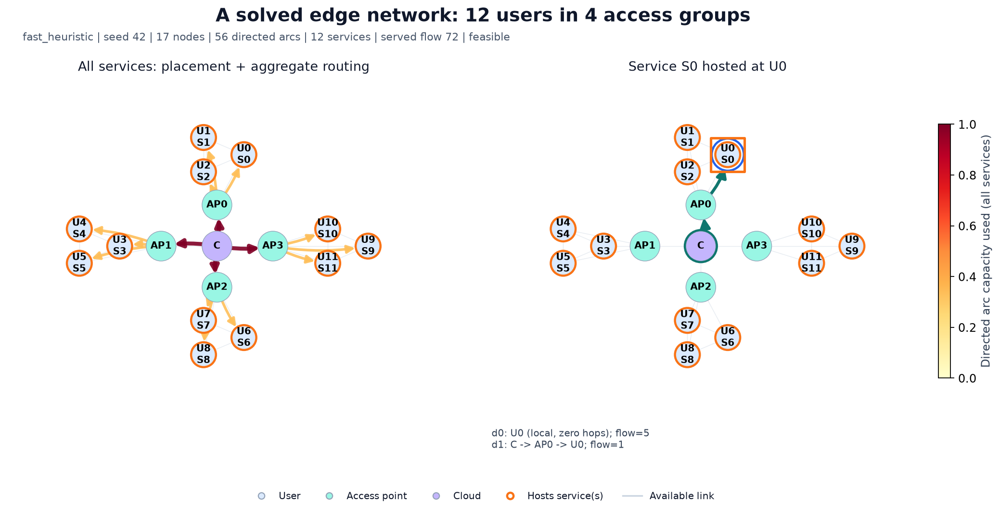
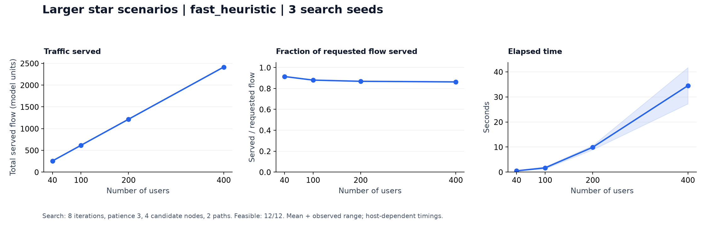

# MEC Placement Benchmarks

**Benchmark service placement strategies before integrating them into an edge network orchestrator.**

`mecbench` is a Python benchmark toolkit for deciding where to host services,
how to route their traffic, and how much demand to serve under latency, compute,
and link-capacity constraints. Train and evaluate reinforcement learning methods
alongside mathematical optimization and heuristic baselines through one API and
a shared feasibility validator.

Built from research presented at **IFIP Networking 2025**, it gives telecom and
industrial R&D teams an executable starting point for evaluating orchestration
strategies in their own environment.



*An actual solved scenario: orange outlines mark service hosts, arrows show
directed routing, and the right panel follows one service's demands. Arc colors
in the left panel show capacity usage. Explore the
[400-user network view](docs/assets/large-service-placement-routing.png) in the notebook.*

## From a network scenario to an engineering decision

- **Compare approaches:** exact and relaxed mathematical models, heuristics,
  evolutionary search, PPO/A2C, and hierarchical PPO.
- **Explore operating constraints:** vary network size, latency budgets, node
  resources, and link capacities to study the tradeoff between traffic served
  and computation time.
- **Check every candidate:** a shared validator checks placement, routing,
  flow bounds, resources, capacity, and latency. Invalid candidates receive no score.
- **Keep results usable:** export scores, runtimes, feasibility, solver status,
  seeds, and errors as CSV; generate figures for technical reviews.

For an operator or systems integrator, the workflow is straightforward: start
with the included tree/star scenarios, establish baseline performance, then
construct problem instances that represent the intended network and demands.
Use the same evaluation interface to assess candidate methods before integration.

## Run your first comparison

From a clone of this repository, with **Python 3.10+**:

```bash
python -m pip install -e .
mecbench --instance tree --solvers fast_heuristic heuristic --seed 42 --start-users 10 --stop-users 41 --step-users 10 --output artifacts/data/first_comparison.csv
```

This compares two heuristics on 10, 20, 30, and 40 users and writes a CSV with
their scores, runtimes, and validation outcomes. The base installation needs
NumPy and NetworkX; this example requires no GPU or optimizer license.
The score is total served flow, summed across demands; higher is better for
the same instance.

For interactive exploration, open the
[benchmark notebook](examples/benchmark_walkthrough.ipynb). It plots placement
and routing, compares two heuristics, then scales a separate campaign to
400 users. It exports measurements and experiment metadata. Install with:

```bash
python -m pip install -e ".[benchmarks]" jupyterlab
jupyter lab examples/benchmark_walkthrough.ipynb
```



*Illustrative scaling run: 40–400 users in groups of 20, `neighbors=1`,
`fast_heuristic` with 8 search iterations, patience 3, 4 candidate nodes,
2 path candidates, and seeds 7, 21, and 42. Lines show means; shading shows the
observed range. Seeds vary search on deterministic instances; timings depend
on the host. See the [measurements](docs/assets/large-benchmark-results.csv),
[protocol](docs/assets/large-benchmark-protocol.json), and
[two-heuristic comparison](docs/assets/benchmark-overview.png).*

## Execute in your environment

**Container execution** packages the benchmark as a CLI job, with results
persisted to a mounted directory:

```bash
docker build -t mecbench .
docker run --rm -v "${PWD}/artifacts:/app/artifacts" mecbench --instance tree --solvers fast_heuristic heuristic --seed 42 --start-users 10 --stop-users 41 --step-users 10
```

**Python integration** lets an internal evaluation pipeline build, solve,
and inspect instances:

```python
from mecbench import make_tree_instance, solve

problem = make_tree_instance(n_users=20)
result = solve(problem, solver="fast_heuristic", seed=42)
print(result.objective, result.status, result.validation.feasible)
```

The deployable component is the benchmark runner and Python toolkit. Connecting
its decisions to a live orchestrator requires an integration specific to the
target system. RL and evolutionary dependencies are optional; mathematical
backends require Gurobi and a license. See the
[experiment and Docker guide](docs/experiments.md) for installation profiles.

## Documentation and research

- [API, solver options, and validation](docs/api.md)
- [Benchmark campaigns and Docker](docs/experiments.md)
- [Development, tests, and adding a solver](docs/development.md)
- [Architecture](docs/architecture.md) · [Research directions](docs/research.md)

Research foundation: *Faster Latency-Constrained Service Placement in Edge
Computing with Deep Reinforcement Learning*, IFIP Networking 2025.
Project code is licensed under [MIT](LICENSE).
